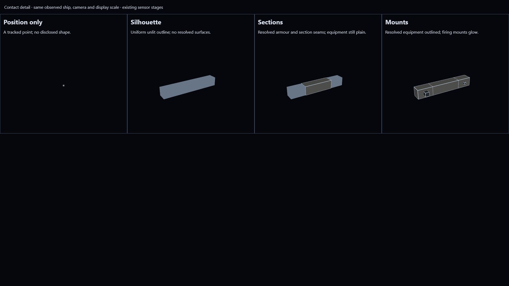

# Contact detail presentation (#70)

The existing sensor stages already describe the useful transitions. They depend on angular
resolution and feature size, so large sections and deployed radiators can resolve before small
mounts. No new distance bands or simulation rules are needed.

While partially resolved, the instrument view keeps all four stage names visible and underlines the current one.
Beside them, a short explanation says what remains unresolved, or counts the sections and
mounts that can be aimed at. Counts describe the current observation, not all installed parts.
The stage moves backwards when range opens or sensor performance falls. An absent contact
clears the caption and hides the stage panel. Test mode explicitly labels its full-detail
exception and hides the sensor-stage ladder.

Normal play also hides the ladder and labels **Full exterior detail** once every surviving
section and mount is resolved, using an explicit simulation observation. Resolving just one
mount still uses the partial contact model. If any surviving part becomes unresolved, the
appropriate partial model and ladder return. See [Detailed contacts](../resolved-contacts.md)
for the observation boundary and a reproducible transition check.

| Stage         | Presentation                                                                          |
| ------------- | ------------------------------------------------------------------------------------- |
| Position only | A fixed-size tracked point without hull dimensions or orientation.                    |
| Silhouette    | A uniform, readable, unlit outline, without resolved surface detail.                  |
| Sections      | Armour shading and outlined seams on resolved sections; unresolved parts stay plain.  |
| Mounts        | Outlined resolved equipment; firing mounts glow and radiators retain their heat glow. |

Partial models use only `ContactObservation`, including its permitted outline and parts. They do not
borrow the stock design's decorative fittings. Fully resolved models use the same detailed
mesh builder as own ships, supplied with permitted exterior geometry and style rather than the
enemy's private design or stores. Partial-contact telescope framing uses the observed
outline dimensions; full detail may use its observed hull size. Targeting continues to use the
same observed sections and mounts. Battle outcomes, sensor thresholds, intelligence and save
formats are unchanged.



This Firefox capture uses the same test ship, camera and display scale in all four views.
Each model receives a real `createBattle` observation at a different range. The review page
is [contact-detail-review.html](contact-detail-review.html); it is available through Vite at
`/docs/research/contact-detail-review.html`. The stage differences are visible in the capture;
human review of legibility during ordinary play remains useful.

For manual verification, with Node.js 24 or newer and desktop Firefox at 1920×1080 or larger,
run this one command from `C:/docs/git/spaceBattle` in PowerShell 7:

```powershell
npm.cmd ci; if ($LASTEXITCODE -eq 0) { npm.cmd run dev }
```

Leave Test mode off. Start a player-controlled free battle, close on the contact and then open
the range. Expect the stage underline, explanation and model detail to agree, including losing
resolved sections and mounts again. Wheel-zoom the telescope: it must not reveal additional
parts. Once all surviving parts resolve, expect the detailed exterior and its explicit caption;
opening the range restores the partial contact model. Repeat in Test mode and expect the
explicitly labelled unconditional full-detail view.
