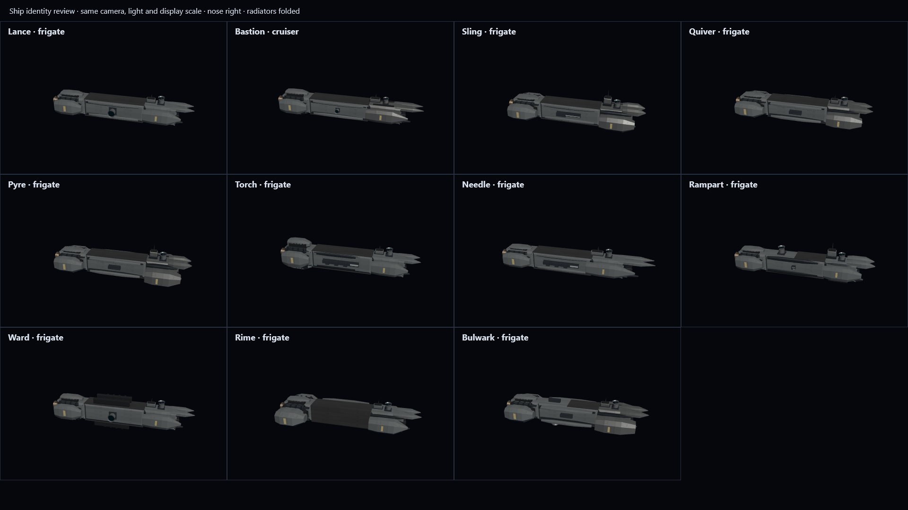
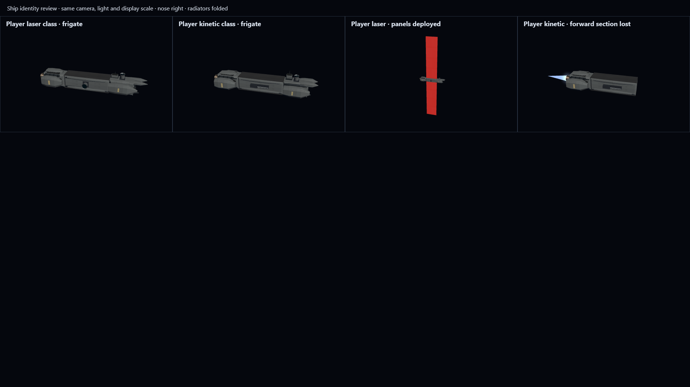

# Ship design identities (#69)

The direction is a family of industrial warships: a quiet structural waist, split armoured prow,
recessed machinery and exposed drive hardware. Equipment changes the major forms rather than
just paint or surface detail. Stock and shipyard designs use the same rules, scaled to their
hull size. Names and IDs have no effect on appearance.

| Design  | Intended identity                                                     |
| ------- | --------------------------------------------------------------------- |
| Lance   | Narrow laser frigate with extended split prow                         |
| Bastion | Larger cruiser with longer twin-laser prow and stronger aft shoulders |
| Sling   | Broad, blunt forward armour around paired kinetic guns                |
| Quiver  | Wide missile-carrier shoulders and narrow machinery waist             |
| Pyre    | Deeper, broader forward magazine housings for nuclear missiles        |
| Torch   | Tall aft machinery housing and raised centre for the charged beam     |
| Needle  | Long, fine forward spars for its neutral particle beam                |
| Rampart | Raised centre and deeper prow, with exposed point defence             |
| Ward    | Prominent dorsal/ventral central housings around the magnetic shield  |
| Rime    | Broad coolant-service shoulders and waist, with its extra radiator    |
| Bulwark | Wide missile shoulders combined with a projecting laser prow          |

## Representative renders

Captured in Firefox at 1920 × 1080, with identical lighting and hull-relative camera distance
for stock designs. Each model occupies a 480 × 290 px viewport, comparable to the shipyard
preview's height; the cruiser is scaled to fit its card. These are shared-model renders,
not concept art. The deployed-panel example is pulled back to include its panels.



These examples are built through the shipyard specification interface on the same frigate hull:
a laser design and a kinetic design with a slug magazine. They also show deployed, hot radiators
and loss of the forward section under thrust.



The implementation review checked silhouettes, framing and visible equipment side by side.
**Human visual acceptance is pending:** these images are provided for that review; automated
checks cannot decide whether the designs look good enough.

## Boundaries and verification

Only UI decoration changes. Section cores, mount positions, simulation geometry, mass, battle
rules and save formats are unchanged. Decoration is deformed around embedded roots, then checked
against both deployed and folded mount envelopes before batching. It disappears with its section.
The shipyard and own-ship/test-mode instrument view share `createShipModel`; limited sensor
contacts retain their existing disclosure rules.

Model tests cover distinct stock proportions, equipment-derived player silhouettes, rename
stability, unchanged core and mount envelopes, clearance, damage visibility and disposal.
Firefox tests render every review image, reject blank images and browser exceptions, and attach
fresh screenshots to their results.

From `C:/docs/git/spaceBattle`, with Node.js 24+ and desktop Firefox, prepare and launch with
this single PowerShell 7 command:

```powershell
npm.cmd ci; if ($LASTEXITCODE -eq 0) { npm.cmd run dev }
```

At 1920 × 1080 or larger, open
[the stock comparison](http://localhost:5173/docs/research/ship-identity-review.html) and
[player/deployment/damage examples](http://localhost:5173/docs/research/ship-identity-review.html?custom).
Compare the prow, waist and aft profiles without zooming. These review pages are development
artifacts, outside the built game menu.

In **Shipyard**, use **Import design** on files in `src/data/designs/` to inspect stock designs
in the rotating preview. Create two frigates with different weapons and appropriate magazines,
save them, then start **Free battle** with **Test mode** enabled and inspect both in the
instrument view. Expect the same appearance, readable equipment, attached fittings and intact
deployment/damage visuals. Turn test mode off and confirm distant contacts still show only what
sensors disclose. Inspection of all viewing angles and aesthetic acceptance remains manual.

To regenerate screenshots, run `npm.cmd run e2e -- e2e/shipAppearance.spec.ts` (install Playwright
Firefox first with `npx.cmd playwright install firefox` if needed). Copy the two images from the
matching `test-results` folders into this directory when updating the reference images.
