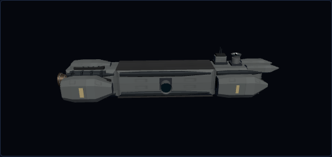

# Capital-ship visual references

Research date: 3 November 2026. These references inform original procedural geometry; their artwork and models are not game assets. Observations and recommendations below are visual design analysis, not claims about fictional engineering.

## Reference images

| Reference                            | Primary source and image                                                                                                                                                                                                                       | Useful visual ideas                                                                                                                                                            |
| ------------------------------------ | ---------------------------------------------------------------------------------------------------------------------------------------------------------------------------------------------------------------------------------------------- | ------------------------------------------------------------------------------------------------------------------------------------------------------------------------------ |
| Homeworld 3 fleet and Khar-Kushan    | [Official Homeworld page](https://www.homeworlduniverse.com/games/homeworld-3/) · [Fleet image](https://www.homeworlduniverse.com/wp-content/uploads/2022/05/img1-1024x538.png)                                                                | Broad quiet armour surfaces surround a concentrated central recess. Contrasting upper/lower layers and strong keels make large forms readable at a distance.                   |
| The Expanse: Donnager                | [Official Syfy concept gallery](https://www.syfy.com/the-expanse/season-1/blogs/the-expanse-concept-art-gallery) · [Concept sheet](https://www.syfy.com/sites/syfy/files/styles/scale_600/public/2015/11/theexpanse_gallery_conceptart_15.jpg) | Pronounced changes in cross section, separate engine masses, broad plates and dark channels. Sparse orange markings connect the larger forms.                                  |
| Star Citizen: Javelin                | [Official RSI introduction](https://robertsspaceindustries.com/en/comm-link/transmission/14335-Introducing-The-Javelin-Destroyer) · [Concept image](https://robertsspaceindustries.com/media/nzqi87nkarvupr/source/Javelin-Sale.jpg)           | Long forward spars frame an open channel. Wide lateral masses and an aft superstructure vary the outline. Mechanical detail sits under armour overhangs.                       |
| Imperial Star Destroyer              | [Official Star Wars Databank](https://www.starwars.com/databank/imperial-star-destroyer) · [Reference image](https://lumiere-a.akamaihd.net/v1/images/Star-Destroyer_ab6b94bb.jpeg?region=0%2C0%2C1600%2C900)                                  | A clear primary silhouette, stepped decks and a dark side trench. Large uninterrupted plates make small machinery read as scale cues rather than visual noise.                 |
| Paul Chadeisson: Homeworld 3 concept | [Artist's original project](https://pao.artstation.com/projects/lxJRKe)                                                                                                                                                                        | Broad slab-like masses, a major circular opening and a continuous dark service band. The substantial empty space matters more to the composition than individual tiny details. |

The Homeworld, Donnager and Javelin images were visually inspected by the research agent. The artist's Homeworld concept and Star Destroyer were inspected directly in the browser. No reference images were copied into the repository.

## Diagnosis of the previous model

The model has surface detail but lacks hierarchy. Equally sized plates and ribs repeat along a nearly constant rectangular cross section. Adding more of those parts does little to change the ship's silhouette or communicate its scale.

## Applied direction

- Establish primary forms first: a faceted armoured prow, broad forward shoulders, a quieter central hull and heavier aft machinery housings.
- Give armour shells tapered ends, substantial overhangs and stepped profiles. Keep the shapes original rather than reproducing a reference vessel.
- Create gaps between exterior structures and dark service beds under their edges; preserve the underlying simulation hull.
- Concentrate conduits, collars and ribs in a few service areas. Reduce continuous, evenly repeated trim.
- Use sparse pale identification bands to reinforce the larger forms. Keep material differences legible without covering every face in markings.
- Keep installed weapons, sensors and both radiator positions clear. Exterior fittings remain render-only, inherit their section's visibility and add no armour, mass, components or hit targets.

## Verification and manual review

The resulting procedural shipyard model:



From `C:/docs/git/spaceBattle`, with Node.js 24 or newer, prepare and launch the game using PowerShell 7:

```powershell
npm.cmd ci; npm.cmd run dev
```

Open **Shipyard** and inspect the rotating preview: the prow, forward shoulders, centre and aft housings should have different profiles, with visible dark gaps and quieter armour surfaces. Compare frigate, cruiser and battleship hulls and add or move mounted components; decorative shells must not obscure them. Start a **Free battle**, deploy/retract radiators, and drag the **Own ship** view to inspect the underside and aft machinery. Fittings should remain clear of the panels and disappear with a destroyed section. Automated model tests cover core hit envelopes, mount clearance, section visibility and disposal; canonical verification is `npm.cmd run verify`.
